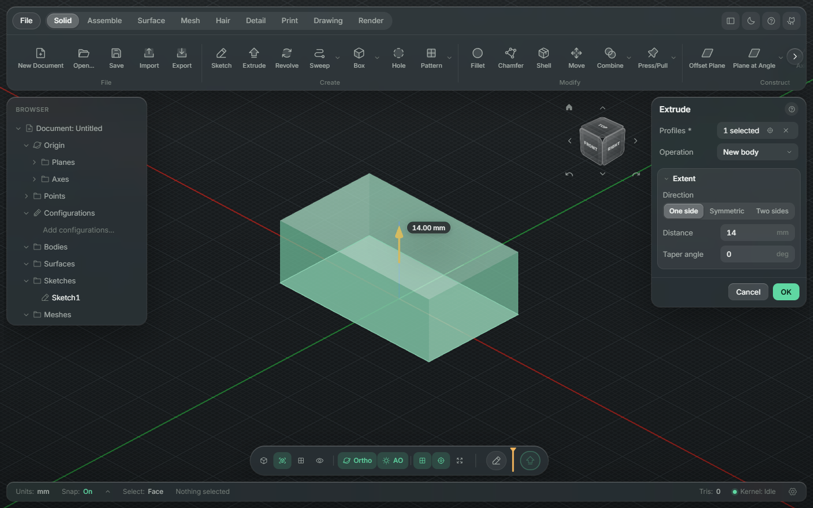
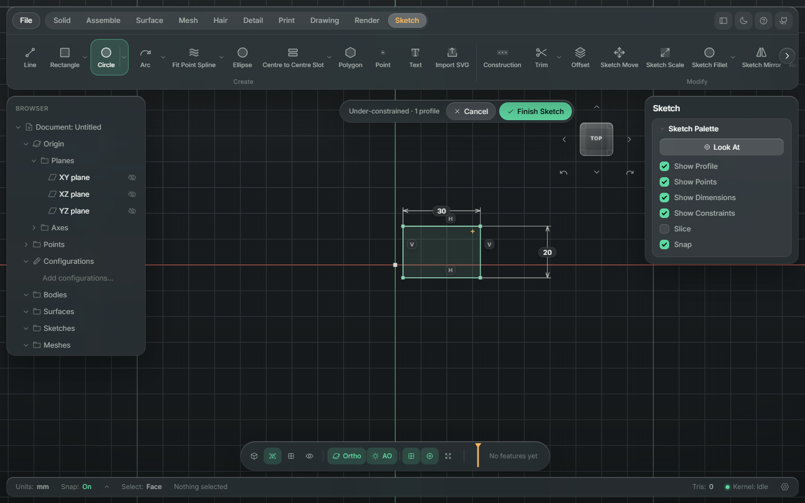
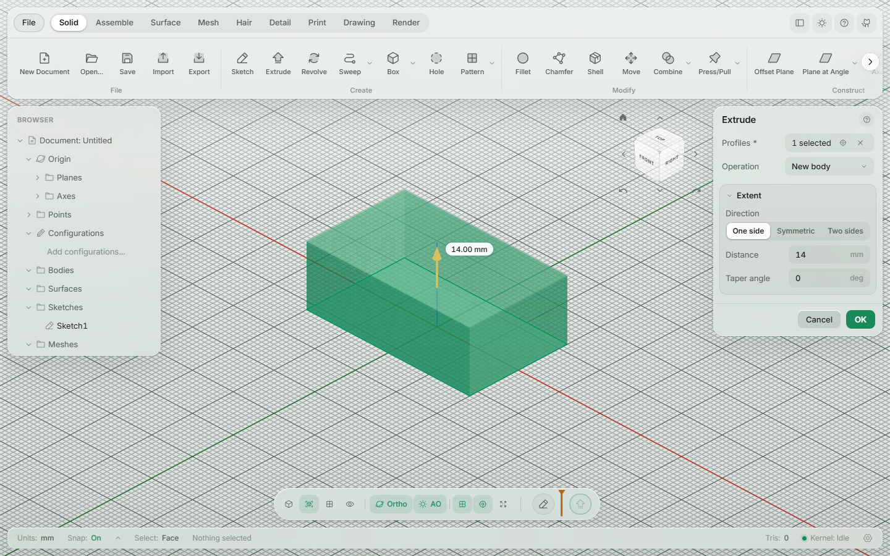
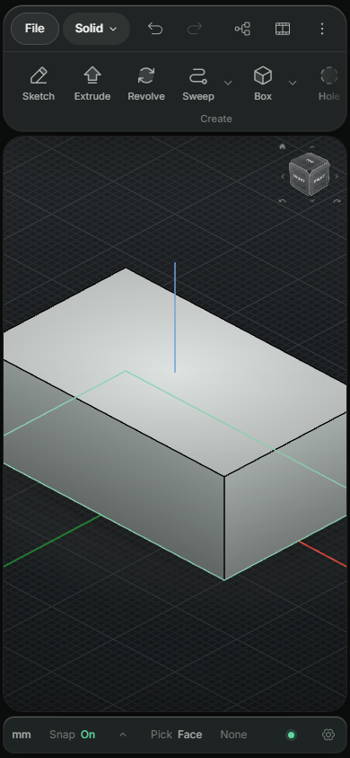

# CADdy McCADFace

[](https://github.com/WrathPak/caddy-mccadface/actions/workflows/ci.yml)

live version: https://wrathpak.github.io/caddy-mccadface/

browser cad that runs 100% on your machine. no accounts, no cloud, nothing gets uploaded. you can host it anywhere static and your files still never leave your computer.

i got tired of fighting fusion 360 for 3d printing stuff (especially hair on figures) so i'm building my own.



<p>
  
  
</p>

## what it does right now

- parametric timeline, edit any feature and everything after it rebuilds
- sketcher that works like fusion's: lines, rects, circles, arcs, slots, polygons, splines, conics, ellipses, text, svg import, trim/extend/break, offset, fillet/chamfer, mirror, patterns, move/copy, every fusion constraint, named dimensions you can use in other dimensions, reference dims when something's already fixed, and the sketch palette
- solids that work like fusion's: sketch on any face and its edges and holes come in ready to dimension and extrude, extrude to an object or through all, revolve, sweep, loft, rib, web, coil, pipe, holes with counterbores and threads, fillets with tangent chains and variable radius, chamfer, shell, draft, combine, move/copy, align, patterns, physical materials, and delete a fillet face to get the sharp corner back
- surfaces: extrude, revolve, sweep, loft and patch open curves into surfaces, then trim, extend, offset, stitch them into solids, thicken them or take a solid apart again
- import/export stl, 3mf, step
- mesh tools (plane cut, reduce, smooth, repair)
- assemblies: components with instances, linked files, joints (rigid, revolute, slider and more) snapped to faces and edges, drag and drive motion, interference check, exploded views, step and 3mf export of the structure
- hair tool: paint faces, pick a direction, get printable strands with a sacrificial wall
- detail: text, logos, textures, fur, scales and threads on faces
- print prep: colors, support checks, splitting, hollowing, and a 3mf ready for your slicer
- drawings: 2d sheets with views, dimensions and notes, export to pdf, dxf or svg
- render: materials, realistic pictures and turntable videos
- saves `.caddy` project files straight to your disk
- glass ui: the model runs full screen with frosted floating panels over it, dark and light themes (blur turns itself off on machines without a gpu, or switch it in settings)
- works on phones and tablets: a phone layout with sheets for the browser, timeline and inspector, finger orbit/pan/pinch, tap-to-sketch with an aiming reticle, share-sheet saves, and it installs as an app
- projects panel: pick a folder and browse your `.caddy` files with thumbnails, search, recent files and a trash
- version history: every save keeps a version inside the file, you can preview, compare and restore them
- plugins: add your own features and commands as small javascript files that run in a sandbox, plus a script panel for quick experiments (see docs/plugins.md)
- built-in help: tooltips on every button and field, a first-run tour, a guide for each workspace, a shortcut list that is built from the commands, and a settings dialog (units, theme, navigation, display, autosave)
- big meshes: multi million triangle stl and 3mf files import in the background and stay smooth to orbit
- give feedback straight from the help menu



## running it

```
pnpm install
pnpm dev
```

tests: `pnpm test` (unit) and `pnpm exec playwright test` (browser). see CONTRIBUTING.md if you want to help out

## under the hood

opencascade (via replicad) for solids, manifold-3d for meshes, planegcs for the sketch solver, three.js for the viewport.

AGPL-3.0 licensed, see LICENSE
